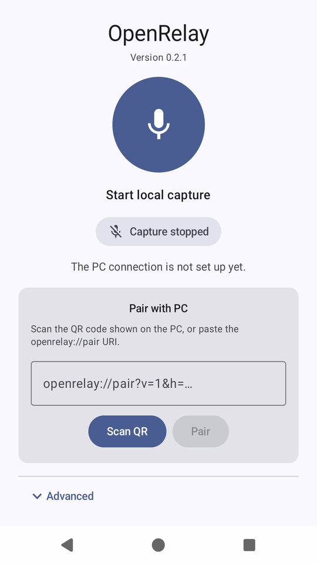

<p align="center">
  
</p>

<h1 align="center">OpenRelay</h1>

<p align="center">
  <b>Use your Android phone as a microphone on your Linux PC.</b>
</p>

<p align="center">
  <a href="https://github.com/MrFaviod/OpenRelay/releases/latest"></a>
  <a href="LICENSE"></a>
  
  
</p>

<p align="center">
  <a href="#install">Install</a> ·
  <a href="#usage">Usage</a> ·
  <a href="docs/cli-quickstart.md">CLI guide</a> ·
  <a href="INSTALL.md">Install guide</a>
</p>

---

The app captures the phone's microphone and sends it to the PC over Wi-Fi. On Linux it shows up as a regular input device, **`openrelay-mic`**, that you can pick in Discord, OBS, Zoom, Audacity or any other app.

<p align="center">
  
  &nbsp;
  
  &nbsp;
  
</p>

- **Low latency.** Audio travels over QUIC datagrams with a 10 ms jitter buffer. A late packet is dropped, never resent.
- **Paired, encrypted.** You pair once with a QR code and confirm it on the PC. After that every connection uses mutual TLS.
- **Small.** One ~3 MB binary on Linux, and a native Android app.

## Install

**Linux** (x86_64 or aarch64, PipeWire 0.3.65+, e.g. Ubuntu 24.04, Debian 12, Fedora 39):

```sh
curl -fsSL https://raw.githubusercontent.com/MrFaviod/OpenRelay/main/install.sh | sh
```

It installs `openrelay` into `~/.local/bin` (no root) after checking the download against `SHA256SUMS`.

**Android** 9 or newer: get `openrelay-0.2.1-android-debug.apk` from the [latest release](https://github.com/MrFaviod/OpenRelay/releases/latest) and install it.

Manual install, building from source and per-distro packages are in the [install guide](INSTALL.md).

## Usage

**1. Start the daemon**

```sh
systemctl --user enable --now openrelay.service   # or just: openrelay daemon
```

If you have a firewall, open UDP 47000–47001:

```sh
sudo ufw allow 47000:47001/udp
```

**2. Pair the phone** (only once)

```sh
openrelay pair
```

It prints a QR code and an `openrelay://pair?...` link. In the app, tap **Emparejar con PC**, scan the QR (**Escanear QR**) or paste the link, then tap **Emparejar** and answer `y` on the PC when the fingerprint appears.

The app and CLI prompts are in Spanish.

**3. Talk**

Tap **Iniciar captura local** in the app. Select **openrelay-mic** as the microphone in your PC app.

Useful commands:

```sh
openrelay status            # is it running, how many phones are connected
openrelay devices           # paired phones
openrelay devices remove <fingerprint>   # unpair a phone
```

More in the [CLI guide](docs/cli-quickstart.md).

## Not there yet

- The gain slider in the app doesn't change the volume yet.
- Mute only works from the phone.
- Audio from the PC back to the phone isn't available.
- The APK is a debug build, not on the Play Store.

Tried it on your phone and distro? [Open an issue](https://github.com/MrFaviod/OpenRelay/issues) with what worked and what didn't.

## Build from source

```sh
# Ubuntu 24.04 / Debian 12
sudo apt install build-essential pkg-config clang libclang-dev cmake \
  libpipewire-0.3-dev libspa-0.2-dev libpulse-dev libopus-dev

git clone https://github.com/MrFaviod/OpenRelay && cd OpenRelay
cargo build --release --locked -p openrelay-cli   # -> target/release/openrelay
```

The Android build is in [INSTALL.md](INSTALL.md#android-from-source).

## Docs

[Install guide](INSTALL.md) · [CLI guide](docs/cli-quickstart.md) · [Protocol](docs/protocol.md) · [Security](docs/security/threat-model.md) · [Pairing](docs/security/pairing.md) · [Changelog](CHANGELOG.md)

## License

[MIT](LICENSE) © OpenRelay contributors.
