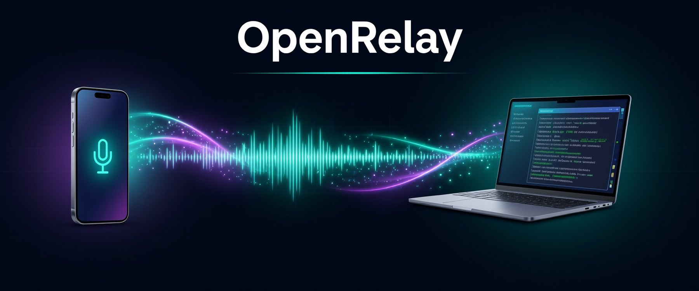
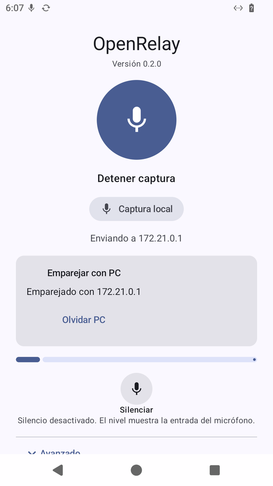

<p align="center">
  
</p>

<h1 align="center">OpenRelay</h1>

<p align="center">
  <b>Turn your Android phone into a microphone for your Linux PC, over your own LAN.</b><br>
</p>

<p align="center">
  <a href="https://github.com/MrFaviod/OpenRelay/releases/latest"></a>
  <a href="https://github.com/MrFaviod/OpenRelay/actions/workflows/ci.yml"></a>
  <a href="LICENSE"></a>
  
  
  
</p>

<p align="center">
  <a href="#install">Install</a> ·
  <a href="docs/cli-quickstart.md">CLI quick guide</a> ·
  <a href="INSTALL.md">Install guide</a> ·
  <a href="docs/protocol.md">Protocol</a> ·
  <a href="docs/security/threat-model.md">Security</a>
</p>

---

## The idea

You have a good microphone in your pocket and a Linux box with a bad one, or none at all. OpenRelay connects the two on your local network, and the phone shows up as a normal input device (`openrelay-mic`) that any app can record from.

```
 ┌──────────────┐ QUIC + mutual TLS, LAN only ┌──────────────────────────┐
 │ Android app │ ══════════════════════════════════► │ openrelay daemon │
 │ mic capture │ audio: unreliable datagrams │ PipeWire "openrelay-mic"│
 │ control UI │ ◄─────────────────────────────────── │ `openrelay` CLI │
 └──────────────┘ control: one reliable stream └──────────────────────────┘
```

- **Latency is the design goal.** Audio rides QUIC datagrams; a late frame is dropped, never retransmitted, and a small jitter buffer (10 ms by default) smooths the stream on the Linux side. The 25 ms end-to-end figure is a target, not a measurement yet: see the [latency budget](docs/latency-budget.md).
- **Secure by construction.** Pairing uses a one-time QR token, an SPKI pin and explicit approval on the PC. Every session after that is mutual TLS. There is no cleartext fallback and no `verify=false`.
- **Local only.** The daemon accepts inbound connections from paired devices and nothing else. No HTTP API, no remote shell, no outbound connections.
- **Small.** A single Rust binary, about 3.5 MB (2.8 MB stripped), for the daemon and CLI, an optional `systemd --user` unit, and a native Kotlin app. Linux has no GUI.
- **Shared control.** Phone and CLI speak one configuration contract: revisions, conflict detection, idempotent retries. v0.2.1 still has no hardware applicator, so a write is refused with `unsupported` instead of faked.

## Screenshots

<p align="center">
  
  &nbsp;
  
  &nbsp;
  
</p>
<p align="center"><sub>Idle · capturing, with mute and input level · advanced settings, showing requested vs. effective gain</sub></p>

<p align="center">
  
  &nbsp;
  
  &nbsp;
  
</p>
<p align="center"><sub>Pairing with a PC by QR · sending the microphone to the PC · the real app streaming to a PC on an emulator</sub></p>

## Quick start

**1. Install both halves.** On Linux (x86_64 or aarch64, glibc 2.34+, PipeWire 0.3.65+):

```sh
curl -fsSL https://raw.githubusercontent.com/MrFaviod/OpenRelay/main/install.sh | sh
```

On Android 9 or newer, install `openrelay-0.2.1-android-debug.apk` from the [latest release](https://github.com/MrFaviod/OpenRelay/releases/latest). It is a debug-signed preview build; allow installation from that source when Android asks.

**2. Start the daemon.** Foreground for a first run, or enable the user unit:

```sh
openrelay daemon
# or, after the installer put the unit in place:
systemctl --user enable --now openrelay.service
```

The first start provisions `${XDG_CONFIG_HOME:-~.config}/openrelay/` (server and client CA, empty `identities.json`, `grants.txt`, all `0600`) and listens for sessions on UDP **47000**. Allow both UDP ports through your host firewall:

```sh
sudo ufw allow 47000:47001/udp
# firewalld: sudo firewall-cmd --add-port=47000-47001/udp
```

**3. Pair the phone, then stream.** Run:

```sh
openrelay pair
```

It opens a 120-second window, prints an `openrelay://pair?...` URI and a terminal QR, and waits. In the app tap **Emparejar con PC**, paste the URI (the proven path; scanning the QR with a physical camera is still untested), then confirm the fingerprint the CLI shows. When the app reports **Emparejado con** the PC name, start capture: audio arrives in the PipeWire source node **`openrelay-mic`**, and the app shows **Enviando a** the host. Pick `openrelay-mic` as the microphone in your conferencing or recording app.

## Status: v0.2.1

> [!IMPORTANT]
> **Pairing and streaming work end to end, with the numbers in [docs/testing.md](docs/testing.md).** The synthetic-phone harness (`scripts/e2e/run.sh`, Ubuntu 24.04 + PipeWire + WirePlumber + pipewire-pulse) passes 28 checks: a 440 Hz tone reaches `openrelay-mic` at RMS −15.05 dBFS (pw-record peak 440.01 Hz, parec 439.99 Hz) and `pactl` shows the source RUNNING. The real Android app on an emulator (Android 16, arm64) streamed the same tone at RMS −21.08 dBFS with a 440.37 Hz autocorrelation, `devices remove` closed its session, and the app reconnected on its own after a daemon restart.
>
> **Not proven yet:** QR scanning with a physical camera (the app was paired by pasted URI), a physical phone over Wi-Fi, latency, battery use, several phones at once, and the systemd unit under a real desktop session.

| Piece | State |
|---|---|
| Control protocol v1: revisions, conflicts, idempotency | ✅ implemented, JSON-Schema checked |
| QUIC transport, mTLS sessions, rate limiting | ✅ implemented, regression and fuzz tested |
| Pairing: QR, one-time token, SPKI pin, local approval, ACL | ✅ `openrelay pair` + **Emparejar con PC**; pasted URI proven, camera QR untested |
| Session audio: phone mic → QUIC → PipeWire `openrelay-mic` | ✅ PCM16, verified end to end by the 28-check harness and the real app on an emulator |
| `openrelay devices` / `devices remove` and persisted identities | ✅ `identities.json`, default deny, capabilities per device; removal closes the live session |
| PipeWire virtual source `openrelay-mic` | ✅ needs a running PipeWire session with WirePlumber to link it to apps |
| PulseAudio and ALSA backends | ✅ implemented · ⏳ untested on real hardware |
| Opus codec | 🟡 decoder present and unit-tested, **not negotiated by the app**; the stream is PCM16 in practice |
| Android app: capture, foreground service, mute, pairing | ✅ capture and pairing work on an emulator; mute is phone-side only, there is no PC-side mute |
| Capture gain (`audio.gain_db`) | ⚠️ the slider stores the value; samples are not scaled yet |
| Noise suppression (SpeexDSP) | 🧪 optional feature, off by default |
| Audio back to the phone | ❌ not available in this build; `config set` answers `unsupported` |
| Real phones, real LANs, other distros | ⏳ [needs testers](https://github.com/MrFaviod/OpenRelay/issues) |

The [compatibility matrix](docs/compatibility-matrix.md) lists exactly what has been verified, and where.

## Install

**Linux** (x86_64 or aarch64; glibc 2.34+ and PipeWire 0.3.65 or newer). No root needed. It installs into `~.local/bin`.

```sh
curl -fsSL https://raw.githubusercontent.com/MrFaviod/OpenRelay/main/install.sh | sh
```

The script detects your architecture, downloads the release tarball, **verifies it against `SHA256SUMS`** before installing anything, and puts the optional user unit in `~.config/systemd/user/` without enabling it. Pin a version with `OPENRELAY_VERSION=v0.2.1`, or uninstall with `OPENRELAY_UNINSTALL=1`.

**Android** 9 or newer: download `openrelay-0.2.1-android-debug.apk` from the [latest release](https://github.com/MrFaviod/OpenRelay/releases/latest) and install it. It is a debug-signed preview build; allow install from unknown sources for your browser or file manager.

Rather read before you pipe? The [install guide](INSTALL.md) covers manual installation, per-distro libraries and building from source.

## 30-second tour

```sh
openrelay daemon & # start it in the background for this tour (or use the unit)
openrelay status # version, uptime, sessions, QUIC address, pipewire:{ok}, pair:{...}
openrelay pair # QR + one-time URI; approve the phone here
openrelay devices # paired identities and their capabilities
openrelay capabilities # every key with type, range and the current revision
openrelay config get # full configuration snapshot
openrelay config get audio.mute # read one key
```

A healthy stream shows up in `status` as `"sessions": 1`, `"pipewire": {"ok": true}` and a `pair` block naming whether a window is open. The daemon's `audio.stats` operation reports per-session counters (`pcm16_frames`, `opus_frames`, drops, discontinuities) over the control socket — the quickest way to confirm that frames are actually arriving.

Writes look like `openrelay config set audio.mute true --rev 0`. The revisioned write path is implemented, but v0.2.1 has no hardware applicator: every write answers `unsupported` and leaves the revision untouched rather than claiming a change it did not make.

Everything else is in the **[CLI quick guide](docs/cli-quickstart.md)**.

## Repository layout

```text
crates
  audio-core/ frames, PCM16, jitter buffer, clock drift, latency budget
  audio-linux/ PipeWire source, PulseAudio and ALSA backends
  codec/ Opus wrapper (not negotiated by the app yet)
  dsp/ optional noise suppression (SpeexDSP)
  proto/ strict control and wire format (openrelay.control/v1)
  transport/ QUIC (quinn), mTLS identity, enrollment, rate limits
  daemon/ runtime, sessions, ACL, pairing, return audio
  cli/ the `openrelay` binary
android/ Kotlin app, Rust JNI bridge, native capture in C
contracts/ JSON Schema 2020-12 for control messages and errors
packaging/ systemd --user unit and tarball notes
fuzz/ cargo-fuzz targets for the untrusted parsers
docs/ protocol, security, ADRs, config keys, latency budget
```

## Documentation

| | |
|---|---|
| 🚀 [Install guide](INSTALL.md) | curl, manual tarball, source build, Android |
| ⌨️ [CLI quick guide](docs/cli-quickstart.md) | pairing, everyday commands, config keys, exit codes |
| 📡 [Protocol v1](docs/protocol.md) | control stream, audio datagrams, limits |
| 🔐 [Threat model](docs/security/threat-model.md) · [Pairing](docs/security/pairing.md) · [Hardening](docs/security/hardening.md) | what is defended, and how |
| ⚙️ [Configuration keys](docs/config-schema.md) | every key with range, default and owner |
| 🧭 [Architecture decisions](docs/adr/) | transport, identity, noise suppression, enrollment |
| ⏱️ [Latency budget](docs/latency-budget.md) · [Measuring it](docs/measurement-method.md) | per-stage targets (proposed, not measured) and the measurement method |
| 🧪 [Testing](docs/testing.md) | the E2E harness, the real-app run, and what is still unproven |
| 📝 [Changelog](CHANGELOG.md) | what changed in 0.2.1, 0.2.0 and 0.1.0 |

The README, install guide, CLI quick guide and pairing document are in English. Most protocol deep-dives are in Spanish.

## Building from source

```sh
# Ubuntu 24.04+ / Debian 12+
sudo apt install build-essential pkg-config clang libclang-dev cmake \
  libpipewire-0.3-dev libspa-0.2-dev libpulse-dev libopus-dev

git clone https://github.com/MrFaviod/OpenRelay && cd OpenRelay
cargo build --release --locked -p openrelay-cli # -> target/release/openrelay
cargo test --locked --workspace
```

The toolchain is pinned to Rust 1.80.1 in `rust-toolchain.toml`. The Android build is covered in [INSTALL.md](INSTALL.md#android-from-source).

## Contributing

Reports from real hardware are the most useful thing right now. Include your distro, audio server (`pactl info | head -3`), phone model, Android version, and the output of `openrelay status`.

Before you open a PR:

```sh
cargo fmt --all --check
cargo clippy --locked --workspace --all-targets -- -D warnings
cargo test --locked --workspace
```

## License

[MIT](LICENSE) © OpenRelay contributors. Dependencies keep their own permissive licenses. `libpulse` is linked dynamically. See [licensing](docs/licensing.md) and the [dependency ledger](docs/dependency-ledger.md).
